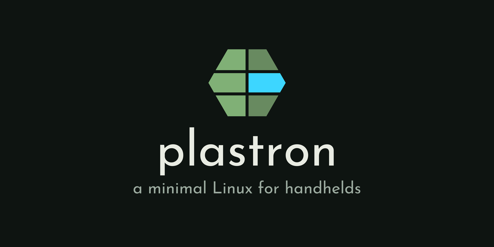

<p align="center">
  
</p>

a minimal Linux for handhelds, built to boot fast and run
[TortOS](https://github.com/ericreinsmidt/TortOS). It runs on two: the GKD
Pixel 2 (Rockchip RK3326S, which Linux calls PX30S) and the TrimUI Brick and
Brick Hammer (Allwinner A133).

On both, the card is the whole system, and plastron is as little as it takes
to boot fast and run TortOS and [diatom](https://github.com/ericreinsmidt/diatom),
its emulator. Nothing is written to a device's own storage: the Brick starts
from the card ahead of its own system, and boots that again without the card.
A plastron is the underside of a turtle's shell, the part TortOS sits on.

## Status

TortOS runs on both. The shelf is up about 2.2 s from power on on the
Pixel 2, and about 1.9 s on the Brick.

The Pixel 2's hardware all works: the display (Panfrost, with the panel's
colors corrected in the display controller's gamma table), sound with
headphone switching and USB-C headphone adapters, every button, power,
brightness and battery. It has no radio of its own; a USB Wi-Fi adapter on
Linux's rtl8xxxu driver gives it Wi-Fi while it's plugged in.

The Brick's does too: the display (Imagination's PowerVR GE8300, through its
closed libraries), sound with headphone switching, every button, power,
brightness, battery, and Wi-Fi and Bluetooth on its XR829 chip. Neither device
has rumble in plastron.

Both reach a computer over the USB cable as a network device (NCM), which
TortOS's Down To The Wire serves its files over; Windows 11, macOS and Linux
need no driver.

The Pixel 2's kernel is kernel.org 7.1.2 with ROCKNIX's patches, config and
device tree from their 20260901 release, the config cut down to what the
Pixel 2 uses, and the patches cut down to the ones it needs: PX30S support,
the panel and joypad drivers, and a few fixes, 19 in all. The Brick's is
Allwinner's Linux 4.9.191 for the A133, from Creality's Sonic Pad SDK, with
plastron's patches: mainline Linux's exFAT driver, the SDK's charger driver,
and the Brick's own changes.

The Pixel 2's bootloader is put together by `make bootloader`: U-Boot
(`buildroot/board/px2/u-boot/`) and TF-A's BL31, both built from source, with
Rockchip's DDR init and miniloader, which are prebuilt blobs, fetched from
Rockchip's rkbin at a pinned commit and checked by sha256. U-Boot records its
own timings in the device tree it hands Linux (bootstage), so where the
bootloader spends its time can be read on the running device under
`/proc/device-tree/bootstage`, with no serial console. The Brick's,
`make brick-bootloader`, is U-Boot with plastron's patches for the A133 and
the Brick, and TF-A's BL31, all built from source.

[THIRD-PARTY.md](THIRD-PARTY.md) says where every part comes from.

## Installing

The card images come with each [TortOS release](https://github.com/ericreinsmidt/TortOS/releases),
one per device. Write one to a card with the TortOS installer, or with any
program that writes disk images. It erases the whole card.

The first boot adds an exFAT partition over the rest of the card, for games,
saves and music, which a Mac or PC can read and write (labeled TORTOS).

## Building

Needs Docker. Everything else - the cross-compilers included - Buildroot
builds from source inside the container. TortOS and diatom are built from
their own checkouts, mounted into the container (see the Makefile).

```sh
make                # out/sdcard.img: TortOS on the Pixel 2's base system
make base           # out/sdcard-base.img: the Pixel 2's base system alone
make linux-rebuild  # just the Pixel 2's kernel, after changing its config or patches
make bootloader     # U-Boot -> buildroot/board/px2/bootloader/u-boot-px2.bin
make brick-kernel   # the Brick's kernel and modules, from all its patches
make brick          # out/brick-sdcard.img: TortOS on the Brick's system
make brick-bootloader  # U-Boot -> buildroot/board/brick/bootloader/
make release        # both devices' release images and sources -> out/release
make third-party    # the package lists, from the last release build
make shell          # a shell in the build container
```

The first build takes a while: it builds the whole toolchain. After that,
Buildroot only rebuilds what changed.

The Brick's build needs its two closed parts, which plastron doesn't include:
Imagination's GPU libraries, in `BRICK_GPU`, and XRadio's XR829 firmware, in
`BRICK_XR829`. `buildroot/package/pvr-ge8300/Config.in` and
`buildroot/package/xr829-firmware/Config.in` say which files they are. Both
come from Creality's Sonic Pad SDK: the GPU libraries from
[`package/libs/libgpu/ge8300/fbdev/glibc`](https://github.com/CrealityTech/sonic_pad_os/tree/7f37a7f/package/libs/libgpu/ge8300/fbdev/glibc)
and the firmware from
[`package/firmware/linux-firmware/xr829`](https://github.com/CrealityTech/sonic_pad_os/tree/7f37a7f/package/firmware/linux-firmware/xr829).
Only those copies match the checksums the build checks them against.

To get SSH access, put a public key in `local/authorized_keys` before
building. `local/` is not tracked. A release build carries no key and starts
no SSH server.

## On the device

Write the card image to a card from sector 0. On the device, the card's exFAT
partition is mounted at `/mnt/SDCARD` (labeled TORTOS, or PIXEL2 on the
Pixel 2's base image).

With the USB cable plugged into a computer, each device appears as a network
interface, and gives the computer an address:

| | Device | Computer | Shell, in a development build |
|---|---|---|---|
| Pixel 2 | 10.42.0.1 | 10.42.0.2 | `ssh root@10.42.0.1`, with the key above |
| Brick | 10.55.0.2 | 10.55.0.1 | `ssh root@10.55.0.2`, with the key above |

## Layout

```
buildroot/                  a Buildroot external tree (BR2_EXTERNAL)
  configs/px2_defconfig     the base Pixel 2 system: boots, display, sound,
                            buttons, power, nothing TortOS-specific
  configs/brick_defconfig   the Brick's system, TortOS included
  board/tortos/             TortOS on the Pixel 2's base: tortos.config
                            (merged into the base config) and its rootfs
                            overlay
  package/                  our packages (splash, Panfrost, jackswitch, the
                            Brick's GPU, firmware and kernel modules, ...)
  board/px2/
    linux.config            kernel config, derived from ROCKNIX's RK3326
                            one by scripts/kernel-config.sh
    patches/linux/          kernel patches, numbered in the order they apply
    dts/                    the Pixel 2 device tree (ROCKNIX's)
    bootloader/             the bootloader written at sector 64: ROCKNIX's,
                            and ours with U-Boot rebuilt (u-boot-px2.bin)
    u-boot/                 U-Boot's patches, ROCKNIX's sources, our config
    boot.cmd                the U-Boot boot script
    genimage.cfg            the card layout
    rootfs-overlay/         files added to the root filesystem
  board/brick/
    linux/patches/          patches to Allwinner's Linux 4.9
    dts/                    the Brick's device tree (Allwinner's, cut down)
    bootloader/             the bootloader, made by make brick-bootloader
    u-boot/patches/         U-Boot's patches for the A133 and the Brick
    boot.cmd, genimage.cfg, rootfs-overlay/    as for the Pixel 2
docker/                     the build containers: Buildroot's, and the
                            Brick's kernel and bootloader
scripts/build.sh            runs Buildroot inside it
scripts/release.sh          builds a release, image and sources
scripts/third-party.py      writes the package lists from the release build
scripts/make-logo.py        draws docs/plastron.svg and the card above
```

## License

plastron's own files are free software under the GNU General Public License,
version 3 or any later version ([LICENSE](LICENSE)); they were MIT until
2026-10-25. The kernel and U-Boot patches, the device trees and the boot
loaders keep their own licenses; [THIRD-PARTY.md](THIRD-PARTY.md) lists them.
The card image carries the licenses and sources of everything in it, which
Buildroot collects with `make legal-info`.
